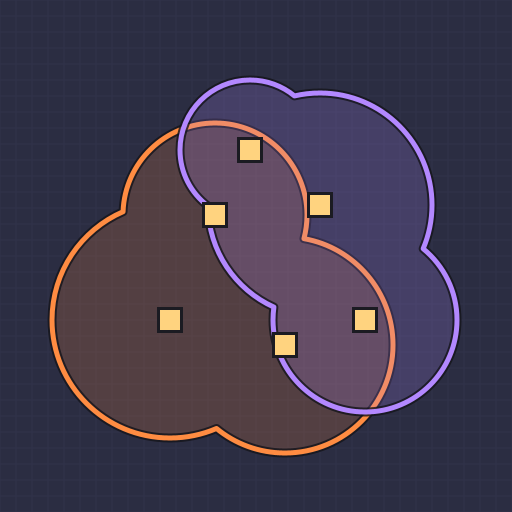

# Turret Reach Indicator

A client-side Mindustry mod that shows your team's turret coverage on the map,
so you can see at a glance where your defense reaches and where the gaps are.

## Features

- **Merged coverage outline.** Overlapping ranges are drawn as one shape with only its outer edge,
  so holes and gaps in your defense stand out. The covered area is lightly shaded,
  and overlaps don't get darker.
- **Filters** for what to show:

  | Filter             | Shows                                                        |
  |--------------------|--------------------------------------------------------------|
  | All turrets        | every turret                                                 |
  | Ground-targeting   | turrets that can hit ground units                            |
  | Air-targeting      | turrets that can hit air units                               |
  | Ground + air       | both layers at once in their own colors, to compare them     |
  | Fire extinguishing | liquid turrets that put out fires (Wave, Tsunami, ...)       |

- **Individual circles** option, if you prefer every turret's own range circle.
- Works on the fullscreen map and the corner minimap.
- Ranges include ammo range bonuses and update as you build or lose turrets.
- Settings are remembered between games.
- **Client-side only.** Works on any server, including ones without the mod. Other players don't need it.

## Installation

Requires Mindustry v8 (build 147 or newer).

**From GitHub (in game)**

1. **Mods → Import Mod → Import From GitHub**
2. Enter `TousTarm/Mindustry_turret_reach_indicator_mod`
3. Restart the game.

**From a zip file**

1. On GitHub, click **Code → Download ZIP**.
2. In game: **Mods → Import Mod → Import File** and pick the downloaded zip.
3. Restart the game.

## Usage

1. Start or join a game and press `M` to open the map.
2. Click the eye button next to **Turret reach** (top-right corner) to show or hide the overlay.
3. Click the gear button to choose a filter.

## Performance and safety

- Turret positions are checked twice per second. When they change, the new overlay is computed in small
  slices across frames (at most 3 ms per frame), so even bases with thousands of turrets don't freeze the game.
- The mod makes no network requests, reads or writes no files, and only stores its own three settings
  (`tri-enabled`, `tri-filter`, `tri-individual`).
- The overlay is drawn through an in-memory map marker that is never added to the saved marker list,
  so it never ends up in save files, maps, or data sent to other players.

## Limitations

- Shows only your own team's turrets.

## License

[MIT](LICENSE)
